## Passive acoustic monitoring

::: r-stack

{.fragment .fade-in-then-out fig-align="center"}

{.fragment .fade-in-then-out fig-align="center"}

{.fragment .fade-in-then-out fig-align="center"}

{.fragment .fade-in-then-out fig-align="center"}

:::

::: aside
 @Gibb_et_al_2019, @Sugai_et_al_2019
:::

## Acoustic localization

::: r-stack

{.fragment .fade-in-then-out fig-align="center" height=600}

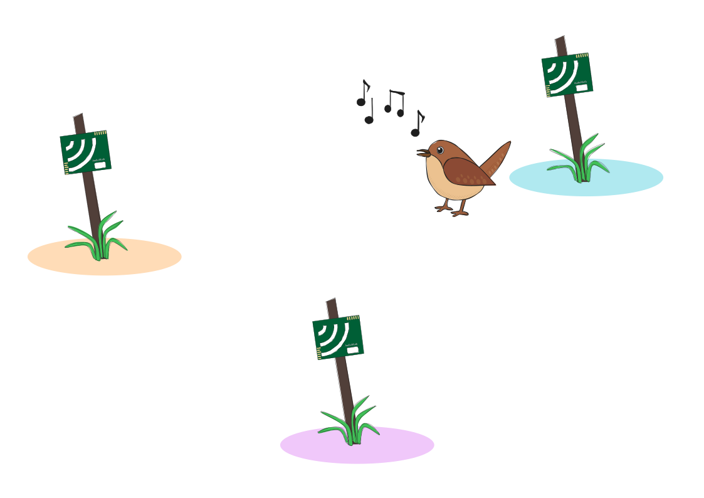{.fragment .fade-in-then-out fig-align="center" height=600}

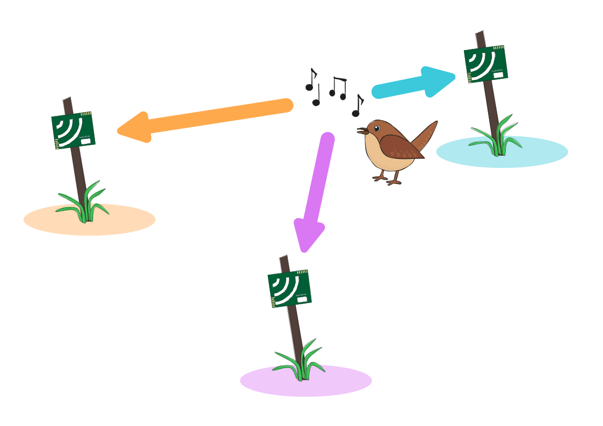{.fragment .fade-in-then-out fig-align="center" height=600}

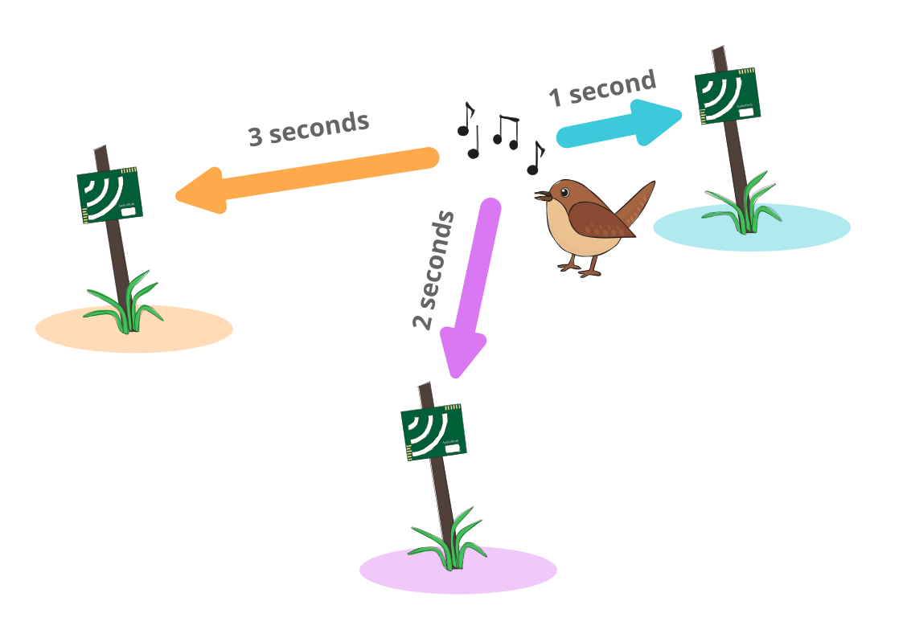{.fragment .fade-in-then-out fig-align="center" height=600}

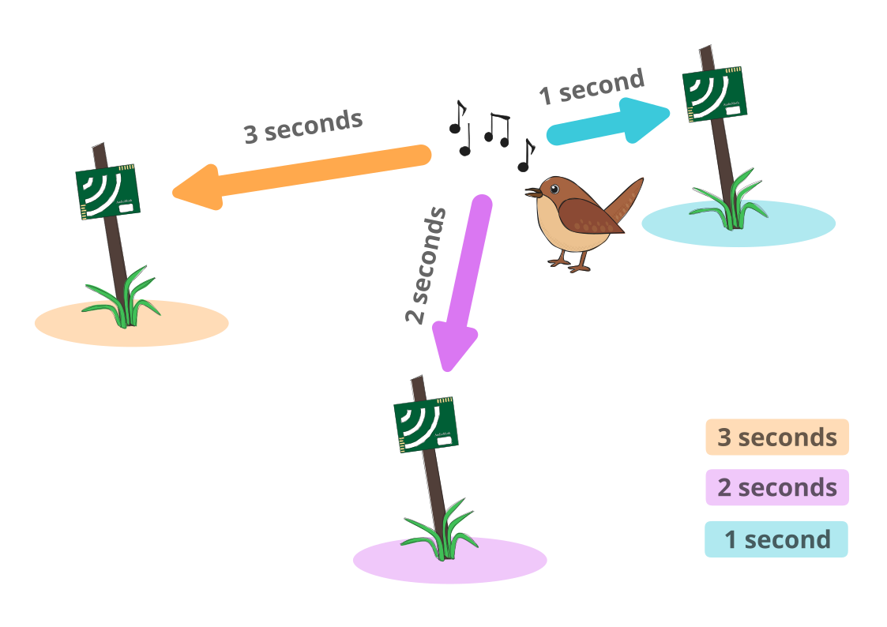{.fragment .fade-in-then-out fig-align="center" height=600}

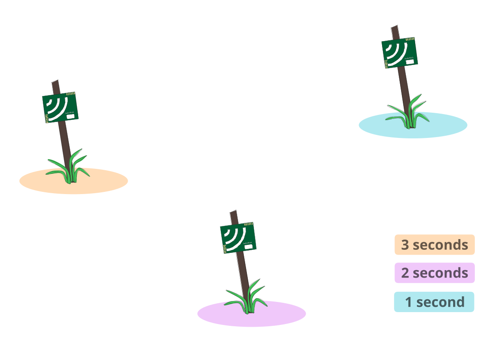{.fragment .fade-in-then-out fig-align="center" height=600}

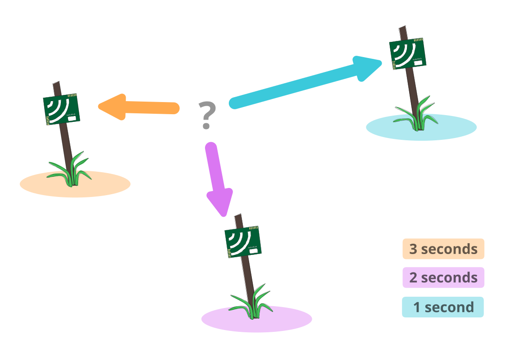{.fragment .fade-in-then-out fig-align="center" height=600}

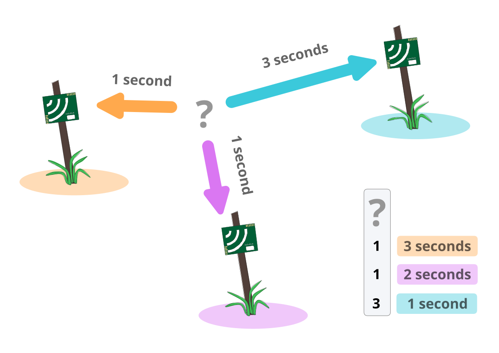{.fragment .fade-in-then-out fig-align="center" height=600}

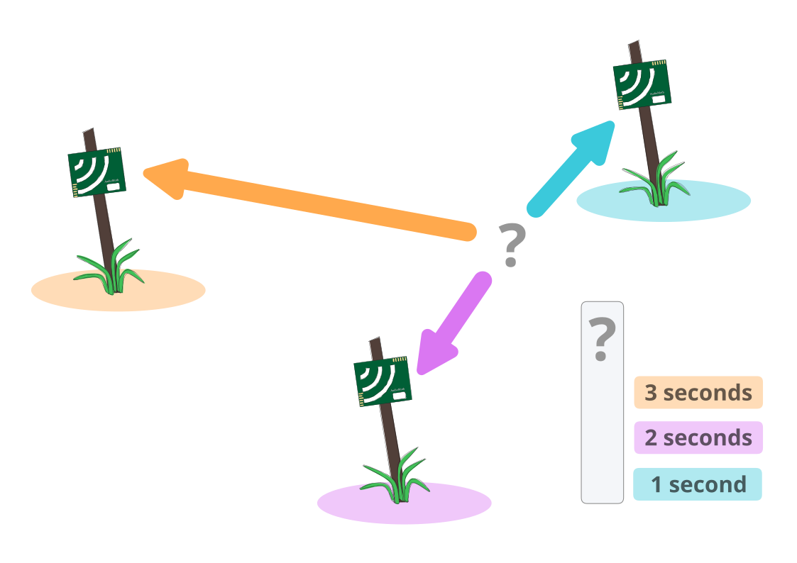{.fragment .fade-in-then-out fig-align="center" height=600}

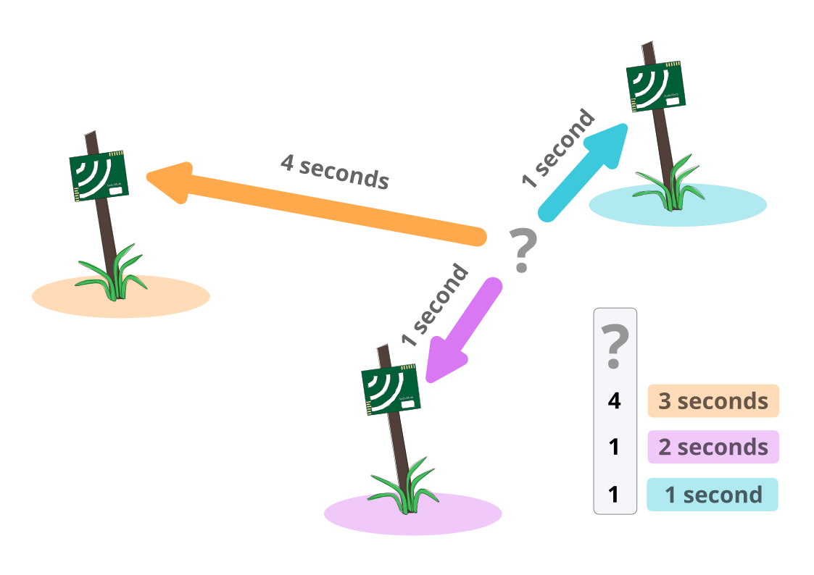{.fragment .fade-in-then-out fig-align="center" height=600}

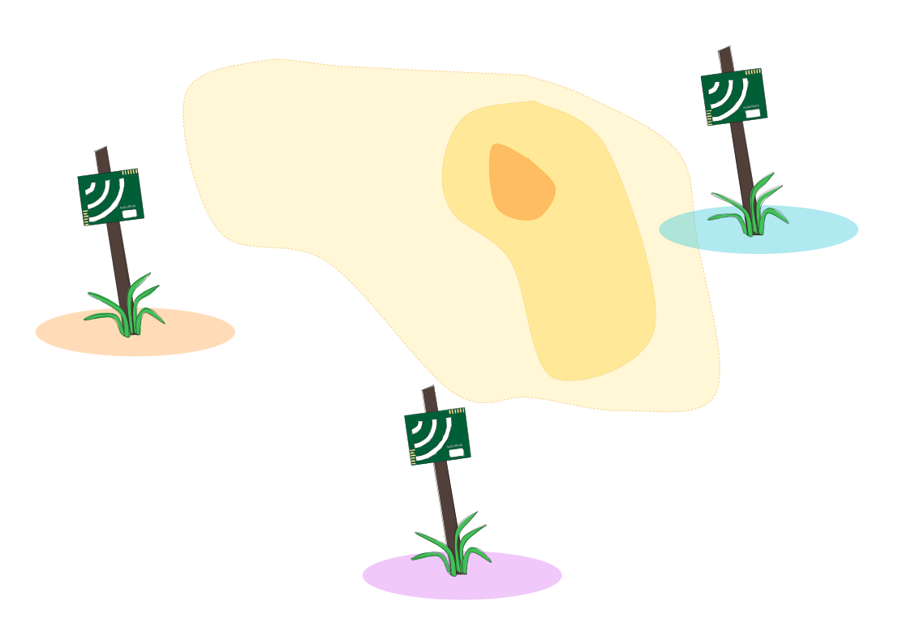{.fragment .fade-in-then-out fig-align="center" height=600}

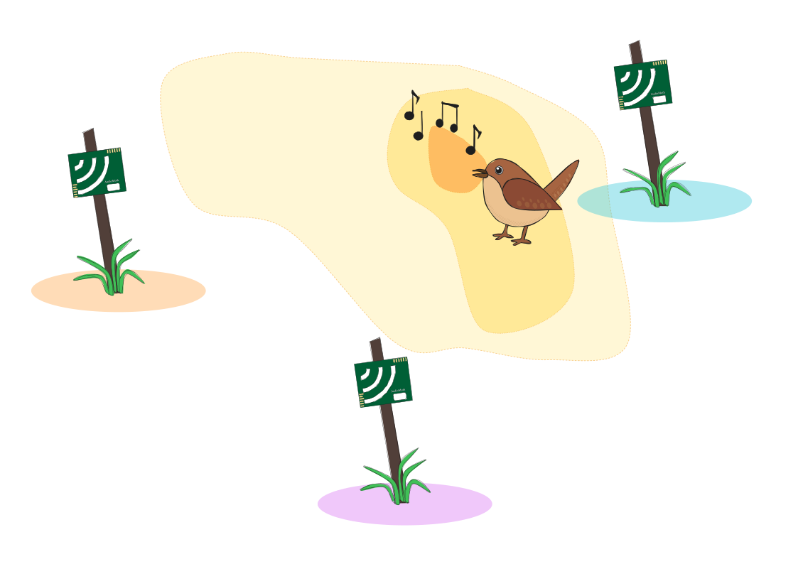{.fragment .fade-in-then-out fig-align="center" height=600}

:::

## Field setup

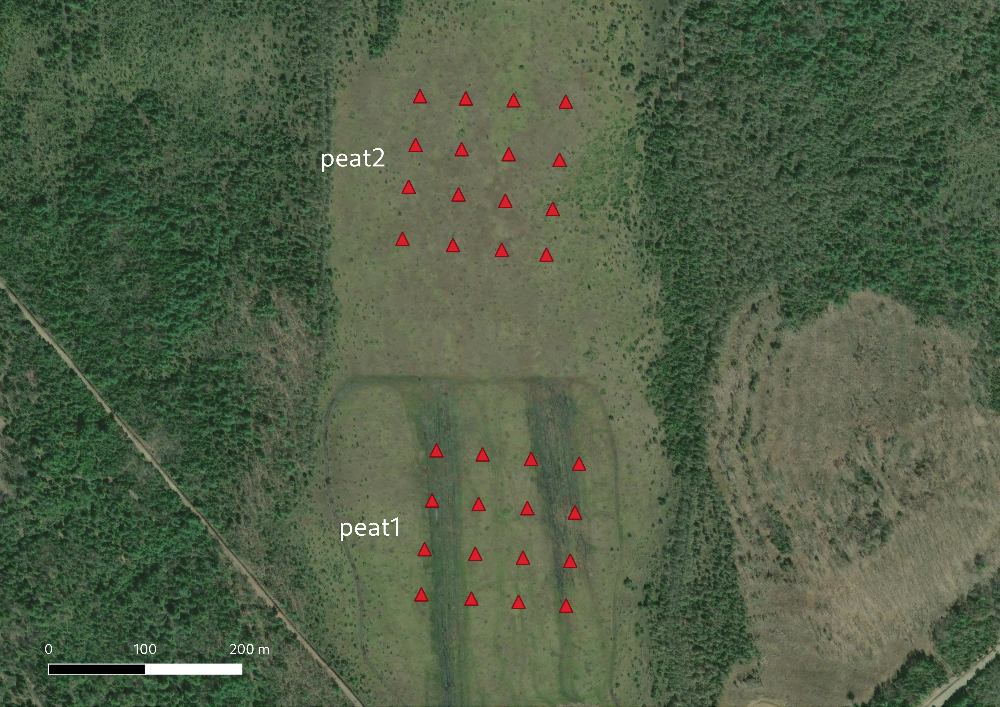{fig-align="center" height=600}

## Data pipeline

 

:::: {.columns}

::: {.column width="50%"}
::: {.callout-note appearance="simple" icon=false}
### 1. Detect
{fig-align="center" height=140}
:::
:::

::: {.column width="50%"}
::: {.callout-note appearance="simple" icon=false}
### 2. Localize
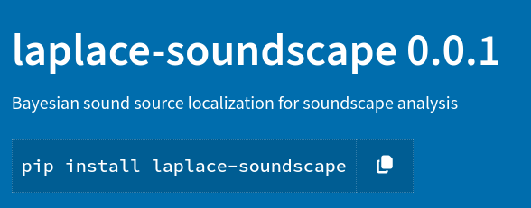{fig-align="center" height=140}
:::
:::

::::

## Results

{fig-align="center" height=600}

## Point process modeling

:::: {.columns}

::: {.column width="60%"}
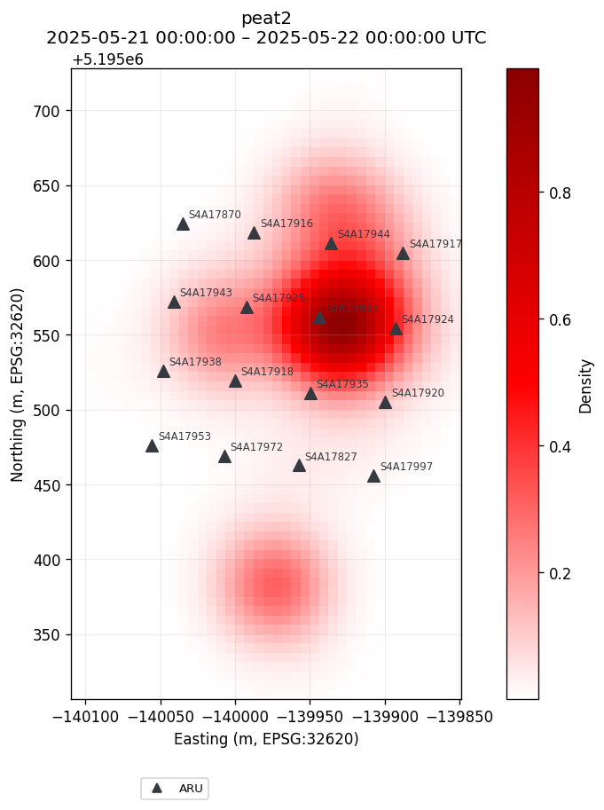{fig-align="center" height=600}
:::

::: {.column width="40%"}

 

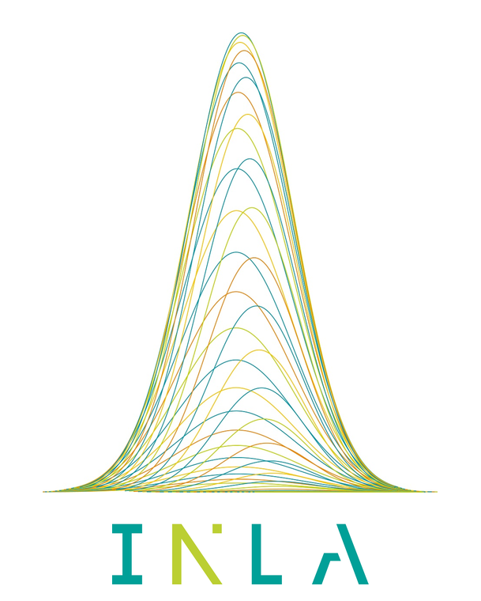{fig-align="center" height=400}
:::

::::

# Thanks!{.smaller}

::: columns

::: column

 
 
 

This work has been funded by
 
 
 
 
 

:::

::: {.column}

{width=6cm fig-align="center"}
 
{width=6cm}

 

:::

:::

::: {.callout-note}
## Contact
 [ lucasvoirin.github.io](https://lucasvoirin.github.io)

 [ lucas.voirin.1@ulaval.ca](mailto:lucas.voirin.1@ulaval.ca)
:::

# References

