# Évaluer des impacts

## Les enjeux

::: r-stack
{.fragment .fade-in-then-out fig-align="center"}

{.fragment .fade-in-then-out fig-align="center"}

{.fragment .fade-in-then-out fig-align="center"}

{.fragment .fade-in-then-out fig-align="center"}

:::

## Le comportement

::: r-stack
{.fragment .fade-in-then-out fig-align="center"}

{.fragment .fade-in-then-out fig-align="center"}

{.fragment .fade-in-then-out fig-align="center"}

{.fragment .fade-in-then-out fig-align="center"}

:::

::: aside
@Mennill_et_al_2006, @Dutilleux_et_al_2023, @Teixeira_et_al_2019
:::

## Le suivi acoustique passif

::: r-stack
{.fragment .fade-in-then-out fig-align="center"}

{.fragment .fade-in-then-out fig-align="center"}

{.fragment .fade-in-then-out fig-align="center"}

{.fragment .fade-in-then-out fig-align="center"}

:::

::: aside
 @Gibb_et_al_2019, @Sugai_et_al_2019
:::

# Localiser des sons

## Sur le terrain

::: r-stack
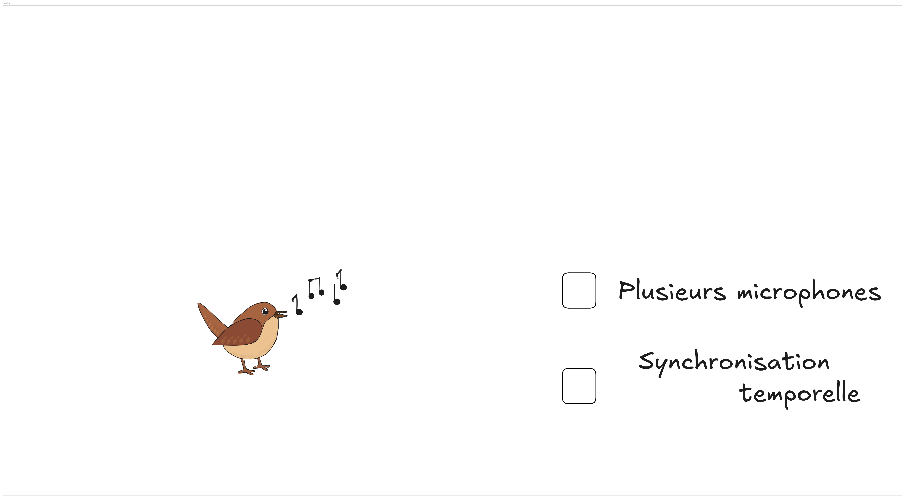{.fragment .fade-in-then-out fig-align="center"}

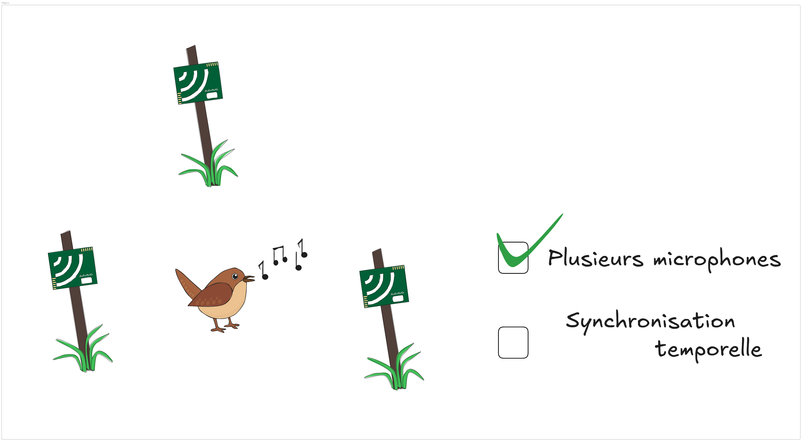{.fragment .fade-in-then-out fig-align="center"}

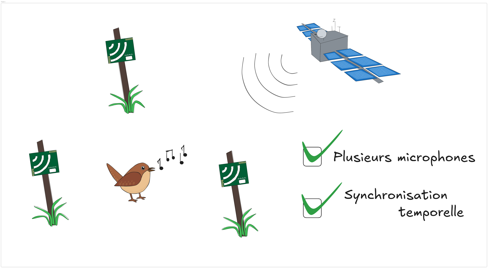{.fragment .fade-in-then-out fig-align="center"}

:::

::: aside
@Rhinehart_et_al_2020
:::

## Objectifs

 

::: {.fragment}
Localiser précisément des sons d'animaux
:::

 

::: {.fragment}
Prendre en compte les incertitudes dans:

- La position des enregistreurs
- Les estimations de délais de temps d'arrivée
:::

## Différences de temps d'arrivée

::: r-stack
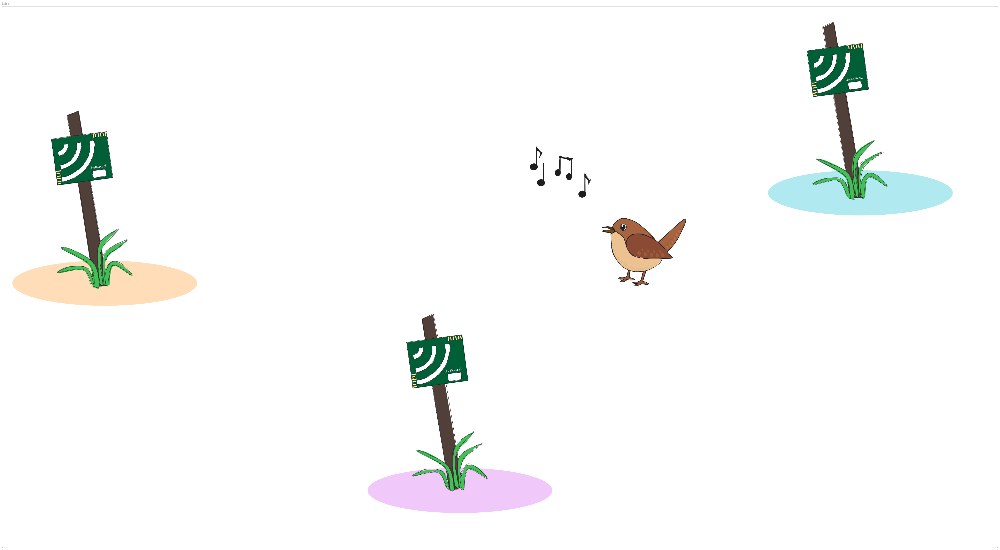{.fragment .fade-in-then-out fig-align="center"}

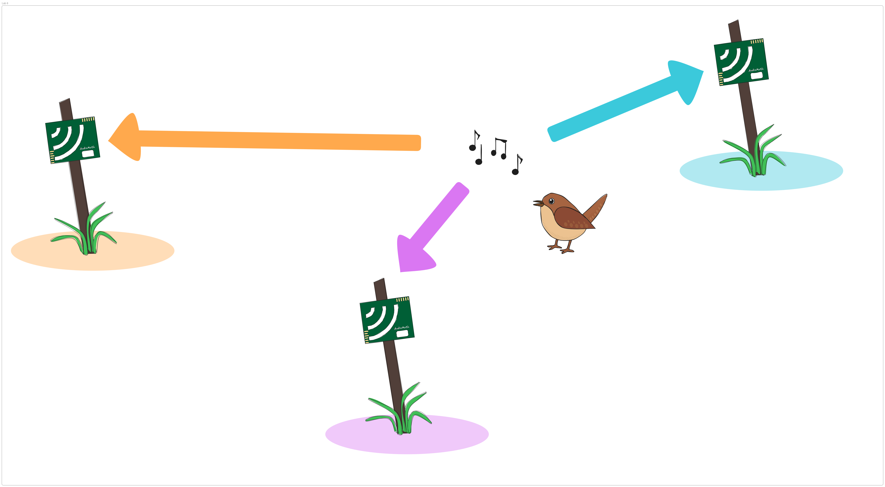{.fragment .fade-in-then-out fig-align="center"}

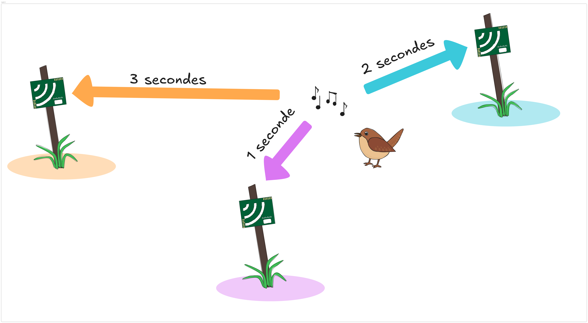{.fragment .fade-in-then-out fig-align="center"}

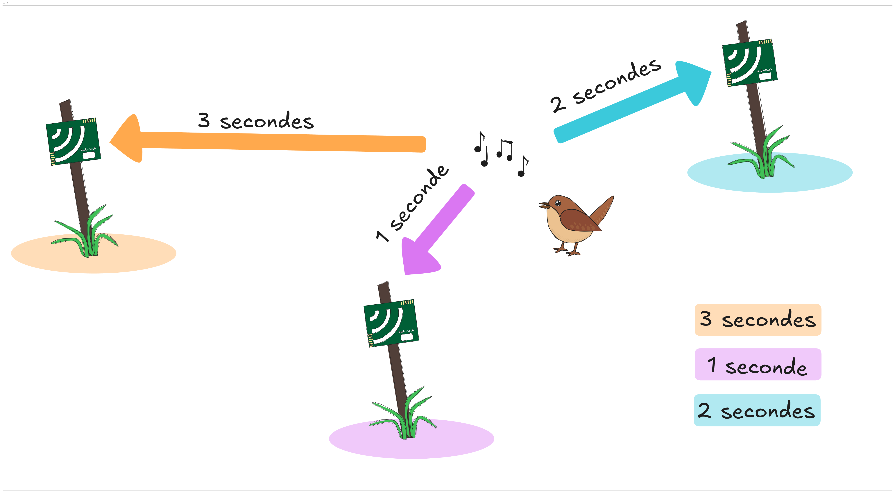{.fragment .fade-in-then-out fig-align="center"}

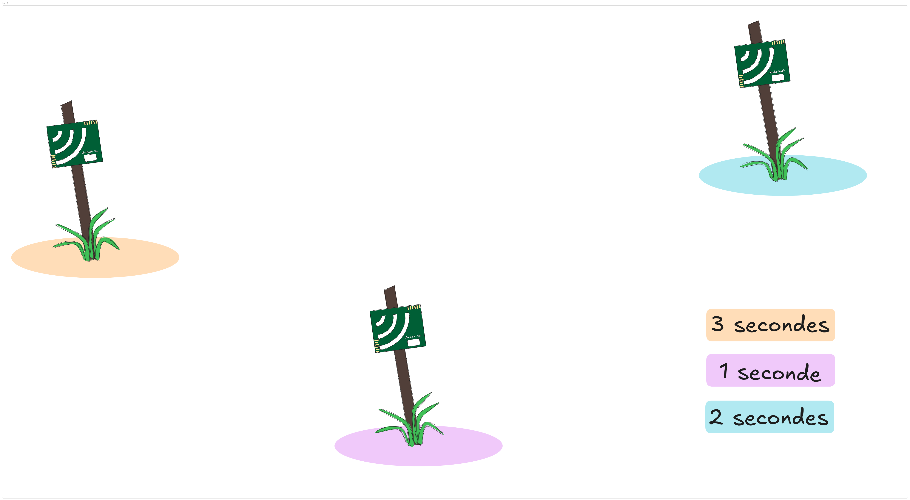{.fragment .fade-in-then-out fig-align="center"}

{.fragment .fade-in-then-out fig-align="center"}

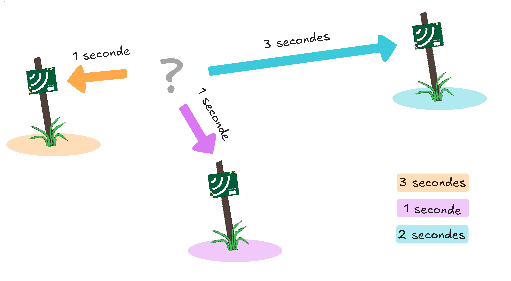{.fragment .fade-in-then-out fig-align="center"}

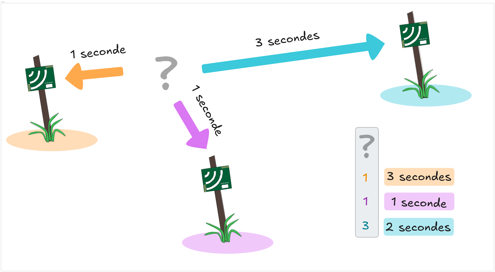{.fragment .fade-in-then-out fig-align="center"}

{.fragment .fade-in-then-out fig-align="center"}

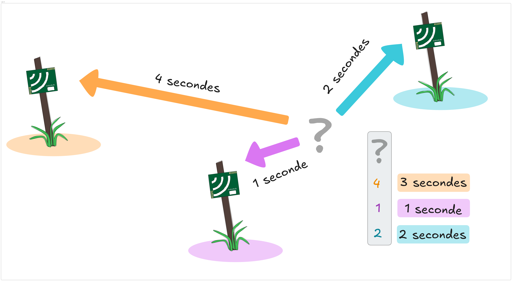{.fragment .fade-in-then-out fig-align="center"}

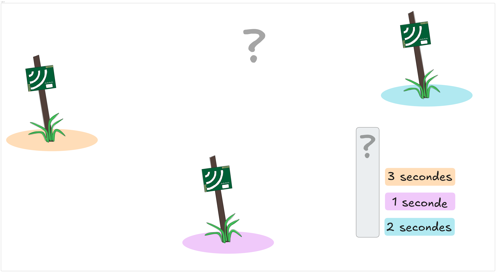{.fragment .fade-in-then-out fig-align="center"}

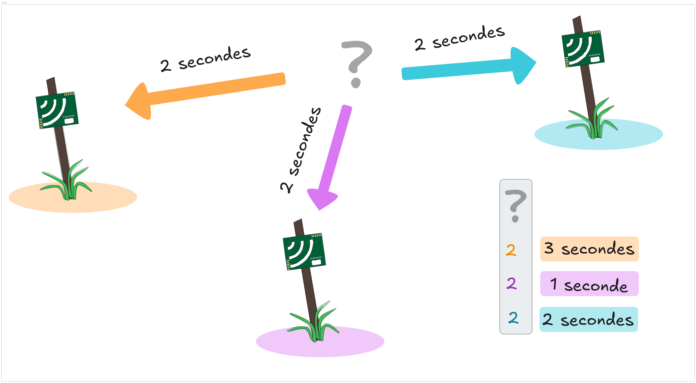{.fragment .fade-in-then-out fig-align="center"}

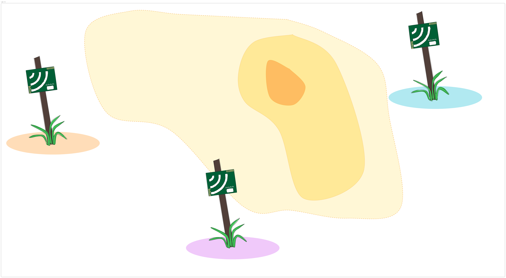{.fragment .fade-in-then-out fig-align="center"}

{.fragment .fade-in-then-out fig-align="center"}
:::

## Localisation de source sonore

::: r-stack
{.fragment fig-align="center" width=80%}

{.fragment fig-align="center" width=80%}

{.fragment fig-align="center" width=80%}

{.fragment fig-align="center" width=80%}

{.fragment fig-align="center" width=80%}
:::

## Évaluer la précision

::: r-stack

{.fragment fig-align="center" width=80%}

{.fragment fig-align="center" width=80%}

:::

## Localiser les enregistreurs

::: r-stack

{.fragment .fade-in-then-out fig-align="center" width=80%}

{.fragment .fade-in-then-out fig-align="center"}

{.fragment .fade-in-then-out fig-align="center" width=80%}

{.fragment .fade-in-then-out fig-align="center" width=80%}

{.fragment .fade-in-then-out fig-align="center" width=80%}

:::

# Cartographier les comportements

## Objectifs {.smaller}

::: columns

::: column

 


 Localiser des sons avec précision

 

Prendre en compte les incertitudes:

-  Positions des enregistreurs
-  Estimation des délais de temps d'arrivée

:::

::: column

{.fragment .fade-in-then-out fig-align="center" width=80%}

:::

:::

# Merci!{.smaller}

::: columns

::: column

 
 
 

Ce travail a été financé par
 
 
 
 
 

:::

::: {.column}

{width=6cm fig-align="center"}
 
{width=6cm}

 

:::

:::

::: {.callout-note}
## Contact
 [ lucasvoirin.github.io](https://lucasvoirin.github.io)

 [ lucas.voirin.1@ulaval.ca](mailto:lucas.voirin.1@ulaval.ca)
:::

# Références

